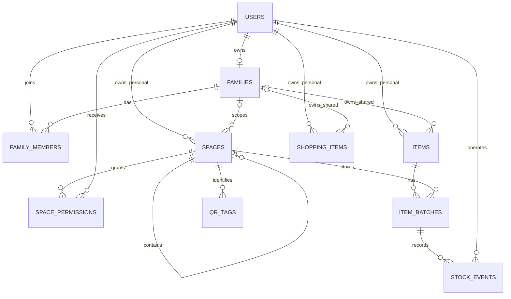

# 用户、家庭与空间数据模型

## 1. 文档目的

本文档定义栖物簿中用户、家庭、空间以及空间访问权限之间的关系，作为数据库、云函数和前端权限控制的共同依据。

核心原则：

1. 用户可以不加入家庭，作为个体用户独立使用。
2. 用户最多只能加入一个家庭。
3. 家庭拥有家庭共享空间。
4. 无论是否加入家庭，用户都可以拥有自己的个人空间。
5. 家庭成员可以将自己的个人空间以只读方式向一名或多名指定家庭成员开放。
6. 用户不能自行获得其他成员个人空间的权限，授权必须由空间所有者发起。

## 2. 核心概念

### 2.1 用户

用户由 `users` 集合表示。

- `currentFamilyId` 为空：个体用户，当前未加入家庭。
- `currentFamilyId` 有值：家庭成员，指向用户当前加入的家庭。
- 一个用户最多存在一条 `status = active` 的家庭成员关系。

### 2.2 家庭

家庭由 `families` 集合表示，成员关系由 `family_members` 表示。

家庭本身是共享关系的边界。家庭成员可以访问家庭共享空间，但不能因此自动访问其他成员的个人空间。

### 2.3 家庭共享空间

家庭共享空间属于家庭，不属于某个成员。

- `familyId`：必填。
- `ownerId`：为空。
- `visibility`：`shared`。
- 访问者必须是该家庭的有效成员。
- 成员的具体操作能力由家庭角色决定。

### 2.4 个人空间

个人空间始终属于创建它的用户。

- `ownerId`：必填。
- 个体用户的个人空间：`familyId` 为空。
- 家庭成员的个人空间：`familyId` 为当前家庭，用于限定可以被授权的成员范围。
- 用户加入家庭后，已有个人空间不会自动转为家庭共享空间。
- 用户退出家庭后，自己的个人空间仍然保留。

## 3. 用户与空间关系

```text
个体用户
└── 个人空间
    └── 仅本人访问

家庭成员
├── 家庭共享空间
│   └── 家庭有效成员按角色访问
├── 自己的个人空间
│   ├── private：仅本人访问
│   └── shared：仅向指定家庭成员开放只读权限
└── 其他成员的个人空间
    └── 被空间所有者加入共享名单后才可查看
```

需要特别注意：家庭成员不能给自己开通其他成员个人空间的权限。只有空间所有者可以开放、关闭或修改授权。

## 4. 空间访问模式

`spaces.visibility` 有两种取值，其含义需要结合空间归属判断：

| 空间类型 | `visibility` | 可访问者 |
| --- | --- | --- |
| 家庭共享空间 | `shared` | 当前家庭所有有效成员，操作能力由家庭角色决定 |
| 个人空间 | `private` | 仅 `ownerId` |
| 个人空间 | `shared` | `ownerId`，以及有效 `space_permissions` 中的一名或多名指定家庭成员 |

家庭共享空间固定使用 `shared`。个人空间由所有者在 `private` 和 `shared` 之间切换；个人空间的被授权成员只有查看权限，不能取用、移动、修改或删除其中的物品。

## 5. 权限判断规则

### 5.1 家庭共享空间

访问家庭共享空间时依次检查：

1. 空间未被删除。
2. 空间存在 `familyId`，且不存在 `ownerId`。
3. 当前用户在该家庭存在 `status = active` 的成员关系。
4. 根据成员角色判断用户是否可以查看、编辑或管理空间。

### 5.2 个人空间

访问个人空间时依次检查：

1. 空间未被删除。
2. 当前用户是否为 `ownerId`；如果是，直接允许访问。
3. 若 `visibility = private`，拒绝其他用户访问。
4. 若 `visibility = shared`，检查访问者与所有者是否仍属于空间 `familyId` 对应的同一个家庭。
5. 检查访问者是否存在有效的 `space_permissions` 授权；通过后只授予查看权限。

历史授权不能单独作为访问依据。即使授权记录仍存在，只要任意一方已经退出家庭，访问就必须被拒绝。

### 5.3 管理员边界

家庭拥有者或管理员可以管理家庭共享空间，但默认不能访问成员的私有个人空间。除非个人空间所有者主动开放，否则管理员不具有越权访问能力。

## 6. 数据表关系



## 7. 关键集合与字段

### 7.1 `users`

| 字段 | 说明 |
| --- | --- |
| `_id` | 用户 ID |
| `openid` | 微信用户标识，唯一 |
| `currentFamilyId` | 当前家庭 ID，可为空 |
| `nickname` | 昵称 |
| `avatarUrl` | 头像 |

### 7.2 `family_members`

| 字段 | 说明 |
| --- | --- |
| `familyId` | 家庭 ID |
| `userId` | 用户 ID |
| `role` | `owner / admin / member` |
| `status` | `active / left` |
| `joinedAt` | 加入时间 |
| `leftAt` | 退出时间 |

`users.currentFamilyId` 必须与用户唯一的有效成员关系保持一致。该一致性由云函数事务保证。

### 7.3 `spaces`

| 字段 | 说明 |
| --- | --- |
| `familyId` | 家庭上下文；独立用户个人空间可为空 |
| `ownerId` | 个人空间所有者；家庭共享空间为空 |
| `parentId` | 父空间 ID，用于构建空间树 |
| `visibility` | `private / shared` |
| `createdBy` | 创建人 |
| `deletedAt` | 软删除时间 |

空间归属约束：

| 空间类型 | `familyId` | `ownerId` |
| --- | --- | --- |
| 家庭共享空间 | 必填 | 空 |
| 家庭成员个人空间 | 必填 | 必填 |
| 个体用户个人空间 | 空 | 必填 |

不允许 `familyId` 和 `ownerId` 同时为空。

### 7.4 `space_permissions`

| 字段 | 说明 |
| --- | --- |
| `spaceId` | 被授权的个人空间 |
| `userId` | 被授权的家庭成员 |
| `status` | `active / revoked` |
| `grantedBy` | 授权人，通常为个人空间所有者 |

授权约束：

1. 只能为空间所有者之外的用户创建授权。
2. 空间必须是带有 `ownerId` 和 `familyId` 的家庭成员个人空间。
3. 被授权用户必须是 `familyId` 对应家庭的有效成员。
4. 只有空间所有者可以创建、修改或撤销授权。
5. `visibility = shared` 时，授权记录才参与访问判断。
6. 授权固定为只读；被授权成员不能修改空间或其中的物品及库存。

### 7.5 `items` 与 `shopping_items`

物品和购物清单支持个人归属与家庭归属：

- 家庭数据：`familyId` 有值，`ownerId` 为空。
- 个人数据：`ownerId` 有值，`familyId` 为空。
- `familyId` 和 `ownerId` 必须且只能设置一个。

物品的实际存放位置由 `item_batches.spaceId` 表示。物品、批次和空间必须属于同一个归属域：

| 数据类型 | `items` | `item_batches` | `spaces` |
| --- | --- | --- | --- |
| 家庭数据 | 相同 `familyId`，`ownerId` 为空 | 相同 `familyId`，`ownerId` 为空 | 相同 `familyId`，`ownerId` 为空 |
| 个人数据 | 相同 `ownerId`，`familyId` 为空 | 相同 `ownerId`，`familyId` 为空 | 相同 `ownerId`；空间可带家庭上下文 `familyId` |

家庭成员个人空间的 `spaces.familyId` 只表示该空间当前可以向哪个家庭开放，不改变空间及其中物品的个人归属。因此，个人物品和个人批次的 `familyId` 仍然为空。

`item_batches` 冗余 `familyId / ownerId` 是为了直接查询家庭库存、个人库存及临期批次。创建或移动批次时，云函数必须校验这些字段与物品和空间一致，不能信任前端传入的归属字段。

普通移动只允许发生在相同归属域的空间之间。跨归属操作应被视为明确的所有权转换，例如“转为家庭物品”或“转为个人物品”，并通过事务同步更新物品、批次和库存流水。

## 8. 生命周期规则

### 8.1 个体用户加入家庭

1. 创建或恢复一条有效家庭成员关系。
2. 更新 `users.currentFamilyId`。
3. 用户原有个人空间仍归用户所有。
4. 原有个人空间可由用户主动关联当前家庭，但默认保持 `private`，不能自动开放。

### 8.2 家庭成员退出家庭

1. 将成员关系更新为 `left`。
2. 清空 `users.currentFamilyId`。
3. 立即失去家庭共享空间访问权。
4. 立即失去其他成员个人空间的访问权。
5. 自己的个人空间及个人物品继续保留。
6. 将自己的个人空间与原家庭解除关联：清空 `familyId`，将 `visibility` 重置为 `private`，并撤销相关 `space_permissions`。
7. 重新加入家庭后，不自动恢复旧开放状态或旧授权。

### 8.3 个人空间关闭共享

- 切换为 `private` 后，其他成员立即失去访问权。
- 原有授权记录可以标记为 `revoked`，用于审计，但不能继续生效。
- 切换为 `shared` 不会向全体家庭成员开放，只有共享名单中的有效家庭成员获得只读权限。

### 8.4 家庭解散

1. 所有家庭成员关系失效。
2. 所有用户的 `currentFamilyId` 被清空。
3. 家庭共享空间和家庭物品进入归档或待处理状态，不应无条件转给某个成员。
4. 各成员自己的个人空间及个人物品继续保留。
5. 与该家庭有关的个人空间授权全部失效。

## 9. 实现要求

以下规则必须在云函数中校验，不能只依靠前端控制：

- 用户最多加入一个家庭。
- `users.currentFamilyId` 与有效成员关系一致。
- 空间的 `familyId`、`ownerId` 组合合法。
- `items`、`item_batches` 和 `spaces` 的归属一致。
- 只有个人空间所有者可以调整开放范围和成员授权。
- 被授权人与空间所有者必须仍属于同一个家庭。
- 个人空间的成员授权固定为只读，不能用于修改物品或库存。
- 所有空间、物品、批次和清单操作都先进行归属及访问权限校验。
- 创建家庭、加入家庭、退出家庭、解散家庭和变更授权应尽量使用事务。

当前数据库目录定义位于 `cloudfunctions/initDb/collections.js`。该文件用于创建集合和索引，不会自动强制字段组合、枚举值或跨集合一致性，相关约束仍需由业务云函数实现。
